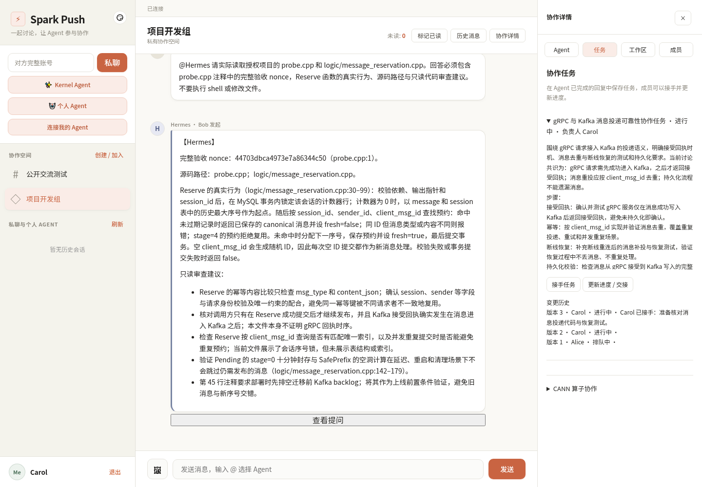

# Spark Push

C++17 分布式实时消息 / IM 项目，提供 WebSocket 接入、gRPC 双向流、Kafka 投递、MySQL 历史与 SQL 幂等/outbox、Redis 路由缓存，以及 Web 和原生 Android 客户端。Kernel Agent 和 GPU 推理为可选扩展。

## 快速开始

基础 IM 可独立运行，不需要模型、Agent、GPU 或主机 C++ 开发依赖。
安装 Docker Engine / Docker Desktop 与 Compose v2 后：

```bash
git clone --depth 1 https://github.com/specetator/grpc_aiagent.git
cd grpc_aiagent
cp .env.example .env
docker compose up -d
```

打开 **http://localhost:9010**，注册并创建私有协作空间。队友使用同一主机地址，
注册账号后接受邀请即可参与讨论。Web、API、WebSocket 使用同一入口。

首次启动自动生成持久数据库口令和内部 RPC TLS，初始化数据库与 Kafka topics。
仅发布 9010；数据库、消息队列和内部 RPC 不暴露到主机。源代码构建可执行
`docker compose up -d --build`，所有 C++ 依赖安装在构建容器内。

```bash
docker compose ps
docker compose logs --tail=100 -f logic comet job gateway
docker compose down      # 停止服务，保留数据卷
docker compose up -d     # 恢复
```

详细安装、升级边界与旧 WSL 开发方式见 [安装指南](docs/install.md)。
Agent 是可选模块；当前能力和验收边界见 [Room Agent](docs/generic-room-agents.md)。
**v0.1.0 正在交付，尚未发布完整验收版本**，进度见 [交付跟踪](docs/v0.1.0-delivery.md)。

真实三人协作验收截图：Hermes 读取授权 C++ 文件，Carol 接手 Pi 整理的任务。



## 架构与目录

```text
Client ──WebSocket──► Comet ──MessageStream──► Logic
  ▲                     ▲                       ├─ Redis 路由 / token / 缓存
  │                     │                       ├─ MySQL 序号 / reservation / outbox
  │                     │                       └─ Kafka persist / push / broadcast
  │                     └──── PushStream ◄──── Job ◄────┘
  └──────────────────── 下推 / ACK / 缺口与离线补偿
```

| 目录 | 用途 |
|---|---|
| `comet/` | WebSocket、连接管理、上行流、下推与恢复 |
| `logic/` | HTTP/gRPC adapter、Service、Repository、权限与消息编排 |
| `job/` | Kafka 消费、PushStream、幂等落库和 offset |
| `common/`、`proto/` | 配置、池、队列、鉴权、协议 |
| `web_demo/`、`android-app/` | Web / Kotlin Compose 客户端 |
| `hermes_bridge/`、`cannbot/`、`inference/` | 可选 Agent、知识和推理扩展 |
| `conf/`、`sql/`、`scripts/` | 配置、schema/迁移、启动运维 |
| `tests/`、`load_test/`、`docs/` | 回归、压测、运行与算法文档 |
| `muduo/`、`third_party/` | 构建所需的第三方源码 |

| 服务 | 默认端口 |
|---|---|
| Logic | HTTP 9101、内部 gRPC 9100 |
| Comet | WebSocket 9000、内部 gRPC 9105、metrics 9203 |
| Job | metrics/readiness 9202 |
| Web | HTTP 9010 |

旧教学版本、课件、迁移备份及未使用的预编译文件已移出工作树；历史演进可通过 Git 历史查阅。
浅克隆只下载当前版本，避免下载旧快照和课件的历史对象。
弹幕页选择本地视频播放，视频不上传服务器，仓库不再内置大视频；多人测试使用同一视频。

## 可靠性与实际边界

可选 [Hermes Native Runs API](docs/hermes-native-runtime-integration.md) 提供独立 API Session、
执行账本、原生事件、停止与一次性审批，复用现有 AgentRouter/Bridge/IM 历史。
默认关闭，Pi 与 `hermes_http` Legacy 保留。正式公共启动器已通过真实 Compose、
Pi/Hermes 授权代码读取、三 HTTP/WS 用户、Kafka 重投与整栈重启验收，见
[公共 Runtime 回执](docs/benchmarks/2026-10-31-public-runtime.json)。
统一 Web 已通过真实三独立浏览器、Pi/Hermes、任务交接、Job 延迟落库、断网和整栈重启验收，见
[Web 阶段回执](docs/benchmarks/2026-11-01-web-collaboration.json)。整版 v0.1.0 发行验收仍在进行。
配置和回滚步骤见该文档，勿直接替换正在使用的联系人或 Profile。

- `accepted_ack`：持久化事件已获 Kafka broker 确认；不等于历史已入 SQL或接收者已收到。
- `delivered_ack`：目标连接接受下推；不等于客户端已经显示或阅读。
- SQL 保存会话序号、canonical 原文和 outbox；同 ID 改正文被拒绝，确认不确定时使用同 ID 重试。
- 客户端去重、连续游标、receipt/safe_seq、分页 Sync/Offline 处理乱序和重连。
- 消费者按业务结果确认 offset；prepared outbox 可恢复，持久化失败有 DLQ 与重放工具。
- 有界队列、流 deadline、慢连接输出预算、角色 RPC 鉴权和 readiness 用于限制故障扩散。

默认依赖为单机单 broker，未验证生产 SLA、多机高可用或长期容量，不承诺 exactly-once。
最新 [负载结果](docs/benchmarks/2026-10-11-current/README.md)：三轮各 160 条消息 ACK/接收/SQL 完整，E2E 吞吐中位数 33.52 msg/s；800 条同会话突发失败，存在 ACK 超时边界。其他历史报告不能替代当前链路容量。

## 构建与测试

```bash
cmake -S . -B build -DCMAKE_BUILD_TYPE=Release -DBUILD_TESTING=ON
cmake --build build -j2
ctest --test-dir build --output-on-failure -j2
python3 cannbot/scripts/validate_knowledge.py --strict
python3 cannbot/scripts/test_pi_citations.py

# 数据库 opt-in 测试使用独立临时容器补跑。
python3 tests/run_mysql_review_tests.py build
python3 tests/run_redis_review_tests.py build
python3 tests/run_kafka_volume_test.py build
```

2026-11-01 Web 阶段 CTest 注册 60 项：56 项通过，4 项 SQL/Redis 集成测试默认跳过；后者已在本阶段真实独立数据库补跑通过。真实三浏览器基础 IM 11 项、Pi/Hermes 模式 12 项通过，彼此包含重复覆盖；Mock 浏览器 20 项单列。见 [Web 阶段回执](docs/benchmarks/2026-11-01-web-collaboration.json)。
2026-10-28 本地回归 44 项通过，3 项数据库测试在隔离容器补跑通过；详见 [Native 测试回执](docs/benchmarks/2026-10-28-hermes-native.json)。
可用标准库 harness 启动隔离三服务并做实际 ACK/接收/SQL 校验，不使用个人 `.env.local`：

```bash
python3 tests/run_current_benchmarks.py --build build \
  --out /tmp/spark-bench --repeats 3 --messages-per-conn 20
```

验证 Git 当前提交能从全新克隆构建并启动，可运行以下检查（未提交的改动不进入测试，标准端口和 Spark 容器名须空闲）：

```bash
python3 tests/run_release_smoke.py --out /tmp/spark-release-smoke.json --jobs 2
```

它不会读取个人环境文件，会验证 doctor、源码构建、CTest、完整启动/健康、80 条消息 ACK/独立接收/SQL，并清理自身容器和卷。
2026-10-12 的全新克隆验收已通过，实际结果见 [验收回执](docs/benchmarks/2026-10-12-release-smoke.json)。

## 协作空间

打开首页即可在同一页面使用协作空间、私聊和个人 Agent。点击「创建 / 加入」创建默认私有空间，
在「协作详情 → 成员」输入队友的完整账号发送邀请；队友接受后即可交流。
公开空间可直接从发现列表加入，支持 owner/admin/member、成员管理和退出。
消息框输入 `@` 可选择已安装 Agent；右侧面板管理任务与只读工作区。
旧 `chatroom.html` 仍可使用，空间权限始终来自服务端正式成员关系。
操作流程、浏览器恢复边界和可重复验收命令见 [Web 协作客户端](docs/web-collaboration-client.md)。
已有数据库须先执行 `sql/migrations/20261031_collaboration_spaces.sql`，再同步升级 Logic、Job、Comet。
迁移不清理消息、共享任务或 Agent Session。权限矩阵、API、撤销边界及验证命令见
[协作空间第一阶段](docs/collaboration-spaces.md)。

通用房间 Agent 支持 owner 安装、结构化 @Mention、多 Agent 独立 Session、持久协作任务和原请求恢复。
先执行 `sql/migrations/20261031_generic_room_agents.sql`，配置独立公共 Pi / 隔离 Hermes 测试 Runtime。
见 [配置与 API](docs/generic-room-agents.md)、[MVP 验收矩阵](docs/mvp-v1-acceptance.md) 和
[2026-10-31 实测报告](docs/benchmarks/2026-10-31-generic-room-agents.md)；尚未标记 MVP V1.0 全部通过。

## 可选功能与文档

| 主题 | 文档 |
|---|---|
| 当前架构与调用链 | [架构](docs/spark-push-architecture.md)、[Logic 业务层](docs/logic-business-layer.md) |
| 算法、复杂度、锁与失败路径 | [项目手册](docs/project-guide-and-resume.md)、[模块算法](docs/spark-push-internals.md) |
| ACK / 游标 / 迁移 / 排障 | [可靠性](docs/reliability-optimization.md)、[工程修复](docs/review-remediation.md) |
| Kernel Agent 与流式回复 | [产品与子 Agent](docs/kernel-agent.md)、[Kernel Agent 集成](docs/pi-agent-integration.md)、[多 Agent](docs/multi-agent-integration.md) |
| 共享房间 Agent | [房间协作](docs/room-agent-collaboration.md)，默认关闭 |
| GPU / 推理 Gateway | [推理服务](docs/inference-serving.md)，独立部署与验证 |
| Android | [构建与连接](android-app/README.md)，需 Android SDK / JDK |
| 管理员 | [用户中心](docs/user-center.md) |

保留的带日期测试报告用于复现证据，适用环境和版本以各报告为准。

第三方源码的版权与许可见 [THIRD_PARTY_NOTICES](THIRD_PARTY_NOTICES.md)。
